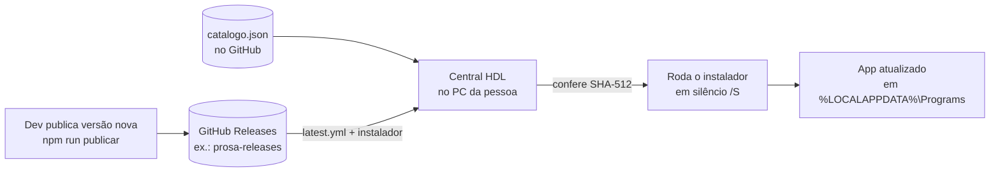

# 1. Como a Central HDL funciona hoje

> Retrato da versão **1.6.0** (branch `main` em 11/11/2026). [← Voltar ao índice](README.md)

## Em poucas palavras

A Central HDL é um programa para Windows que funciona como a **loja de aplicativos interna da HDL**. A pessoa instala a Central uma vez e, a partir daí, ela:

- mostra os programas da empresa que a pessoa pode usar;
- instala qualquer um deles com um clique, sem telas de instalação;
- confere a cada 30 minutos se saiu versão nova e atualiza sozinha (sem interromper quem está com o app aberto);
- atualiza a si mesma;
- fica na bandeja do Windows e abre junto com o computador.

Programas no catálogo hoje:

| App | Para que serve | Quem vê |
|---|---|---|
| Prosa | Chat, chamadas, reuniões e organograma | Todos |
| Fluxo | Demandas, backlog e kanban | Restrito (por acesso) |
| Financeiro HDL | ERP: finanças, vendas e NF-e, estoque, CRM | Restrito |
| Mesa de Pauta | Conduz reuniões e gera a ata em PDF | Restrito |
| Bússola | Assistente com IA sobre os projetos da HDL | Restrito |

Para entrar, a pessoa precisa de uma **conta HDL** (a mesma do Prosa), criada **só por convite** de um administrador e aprovada por ele. Ou seja: hoje a Central é uma ferramenta **interna**, para a equipe.

## O caminho de uma atualização

1. **Catálogo**: a lista de apps fica num arquivo (`catalogo.json`) no GitHub. Para incluir um app novo basta editar esse arquivo. Não precisa lançar uma versão nova da Central.
2. **Versões**: cada app publica as versões no GitHub Releases de um repositório próprio (`prosa-releases`, `fluxo-releases`...). A Central lê o arquivo `latest.yml`, que diz qual é a última versão e qual é a "impressão digital" (SHA-512) do instalador.
3. **O que está instalado**: a Central consulta a lista de "Aplicativos instalados" do Windows (registro `Uninstall`) e compara as versões.
4. **Download e instalação**: baixa o instalador, confere o SHA-512 (se não bater, descarta o arquivo) e roda em modo silencioso. Se o app estava aberto, fecha e reabre.
5. **Sem interromper**: se o app está aberto durante a verificação automática, a Central só manda uma notificação e a pessoa atualiza quando quiser.

## Conta, acessos e administração

- **Login**: e-mail e senha no Supabase (o mesmo banco do Prosa). A sessão fica guardada no computador, criptografada pelo próprio Windows (DPAPI), e funciona sem internet.
- **Convite e aprovação**: um administrador gera um convite (válido por 7 dias, uso único). A pessoa cria a conta, que nasce *pendente* até o administrador aprovar.
- **Acesso aos apps**: cada app é *livre* ou *restrito*. Os restritos só aparecem para quem recebeu acesso. Quem decide é o administrador, na aba **Pessoas** da própria Central.
- **Quem garante o acesso de verdade é o banco de cada app**, não a Central. Os instaladores ficam em repositórios públicos; a Central só esconde o que a pessoa não pode usar.
- **Cargos**: Convidado, Membro, Administrador e Proprietário, com as mesmas regras do Prosa.

## Como a própria Central se atualiza

A Central usa o **electron-updater** apontando para as releases do repositório `hdldev123/central-hdl`. Ela procura versão nova ao abrir e a cada 2 horas, baixa em segundo plano e instala quando é fechada (ou com o botão **Reiniciar e atualizar**).

Só a **primeira** instalação é feita à mão: a pessoa baixa o `Central-HDL-Setup-x.y.z.exe` em `https://github.com/hdldev123/central-hdl/releases/latest`. É **nesse momento**, e só nele, que aparece o aviso do Windows tratado no [documento 2](02-alerta-do-smartscreen.md).

## Como uma versão é publicada

| Passo | Quem faz | Como |
|---|---|---|
| Código pronto | Dev | Branch `feature/...` → PR para `staging` → PR para `main` |
| Subir a versão | Dev | `npm version patch` (ou `minor`/`major`) |
| Publicar | Dev com permissão de escrita no GitHub | `npm run publicar`: gera o instalador e envia `.exe`, `.blockmap` e `latest.yml` para o GitHub Releases |
| Chegar nas pessoas | Automático | Em até 30 min as Centrais encontram a versão nova (a Central se atualiza em até 2 h) |

O script de publicação recusa publicar fora da `main`, com alterações sem commit ou repetindo uma versão já publicada.

## Onde fica cada coisa

| O quê | Onde |
|---|---|
| Código da Central | GitHub `hdldev123/central-hdl` (público) |
| Catálogo de apps | `catalogo.json` na `main` desse repositório |
| Versões dos apps | GitHub `hdldev123/<app>-releases` (públicos) |
| Contas e regras de acesso | Supabase do Prosa (migrações no repositório privado `hdldev123/hello-prosa`) |
| Apps instalados no PC | `%LOCALAPPDATA%\Programs\<App>` (instalação por usuário, sem pedir administrador) |
| Configurações, sessão e cache da Central | `%APPDATA%\Central HDL\` |
| Registro de erros | `%APPDATA%\Central HDL\logs\central.log` |

## Detalhes técnicos (para quem programa)

- **Stack**: Electron 45 + electron-builder 26, alvo **NSIS** (`npm run dist`), instalação *one-click* por usuário (`perMachine: false`).
- **Arquivos principais**: [main.js](../main.js) (processo principal: catálogo, instalação, conta, autoatualização, bandeja), [lib/releases.js](../lib/releases.js) (leitura do `latest.yml` e download com SHA-512), [lib/windows.js](../lib/windows.js) (registro do Windows, `tasklist`, instalador `/S`), [lib/catalog.js](../lib/catalog.js) (validação do catálogo), [lib/conta.js](../lib/conta.js) (Supabase Auth via HTTP), [ui/](../ui/) (interface).
- **Segurança da janela**: `contextIsolation`, `sandbox` e sem `nodeIntegration`. A interface nunca vê os tokens. Links externos só abrem se forem do GitHub.
- **Download dos apps**: feito pelo `net.fetch` do Electron, não pelo navegador. Por isso o arquivo **não recebe a marca "veio da internet"** (Mark-of-the-Web), e o Windows não mostra o aviso do SmartScreen ao rodar esses instaladores. Esse detalhe é importante no [documento 2](02-alerta-do-smartscreen.md).
- **Iniciar com o Windows**: `app.setLoginItemSettings` com o argumento `--oculto` (abre direto na bandeja).
- **Requisito para um app entrar no catálogo**: ter um instalador NSIS que aceite `/S` e publicar `latest.yml` no GitHub Releases (o padrão do electron-builder).

O passo a passo operacional completo (publicar, colocar um app no catálogo, login no GitHub CLI) está no [README principal](../README.md).
